Shaik Hassan, Email: shaik20hassan06@gmail.com

B.Tech Student in CSE (AI & ML) at Woxsen University

Currently studying Computer Science & Engineering.

Tech Stack

    Languages: Python, Java, SQL, C

    ML & Data Science: Pandas, NumPy, Scikit-Learn, Matplotlib

    Web & Frameworks: Streamlit, HTML/CSS, PHP

    Tools & Automation: Git, Linux/WSL, n8n Workflow Automation

<!--
**creat-code/creat-code** is a ✨ _special_ ✨ repository because its `README.md` (this file) appears on your GitHub profile.

Here are some ideas to get you started:

- 🔭 I’m currently working on ...
- 🌱 I’m currently learning ...
- 👯 I’m looking to collaborate on ...
- 🤔 I’m looking for help with ...
- 💬 Ask me about ...
- 📫 How to reach me: ...
- 😄 Pronouns: ...
- ⚡ Fun fact: ...
-->

